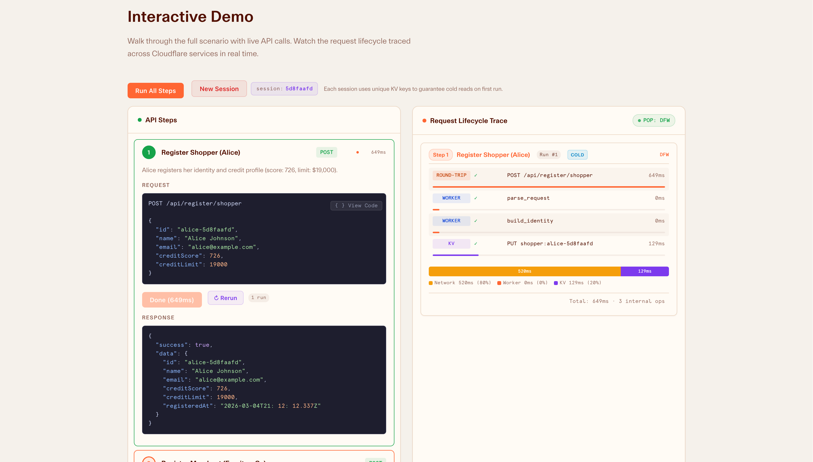
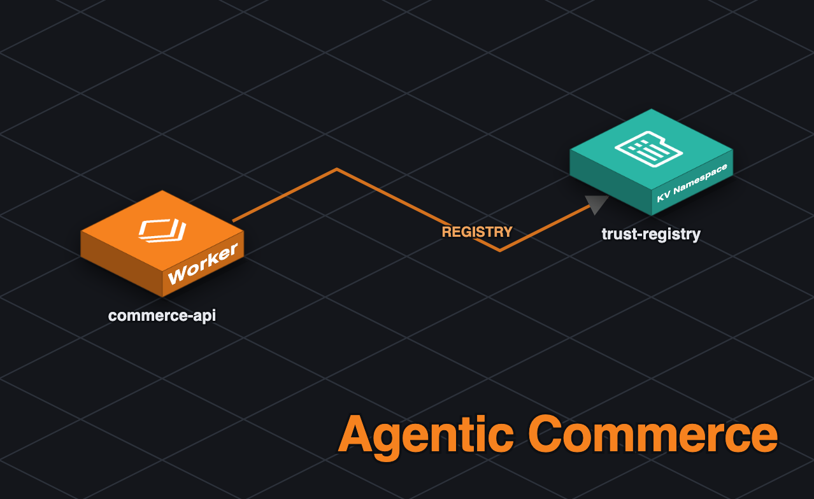

# Agentic Commerce Registry — Cloudflare Workers Demo

See [production guardrails, session ownership, budgets and deployment readiness](docs/app-garden-guardrails.md). Wrangler bundles the hardened `src/production.ts`; the KYA verification flow below lives in the full local demo (`src/index.ts`, exercised by `npm test`) and is not part of the hosted deployment.

[](https://deploy.workers.cloudflare.com/?url=https://github.com/Gryczka/agentic-commerce-registry-demo)
[](LICENSE)
[](https://hono.dev)
[](https://workers.cloudflare.com)

An interactive demo showing how **AI agents, merchants, and shoppers** interact through a delegation and trust registry built on [Cloudflare Workers](https://workers.cloudflare.com) and [Workers KV](https://developers.cloudflare.com/kv/).

**Live demo:** https://agentic-commerce-registry-demo.dwarven.workers.dev/

---



---

## What This Demonstrates

This project is a hands-on walkthrough of the [Cloudflare Developer Platform](https://developers.cloudflare.com), structured as a realistic agentic commerce scenario. Click through each step in the UI to see:

| Concept | What you learn |
|---------|----------------|
| **Cloudflare Workers** | Serverless TypeScript running on Cloudflare's global edge network (300+ locations) |
| **Workers KV** | Globally distributed key-value storage for persisting registry state |
| **Bindings** | How KV namespaces and static assets are wired to a Worker via `wrangler.jsonc` |
| **Hono** | A lightweight web framework designed for Workers, used for routing and middleware |
| **Cold vs. warm latency** | Real-time comparison of first-request vs. cached KV reads |
| **Request tracing** | Per-request span timeline showing Worker execution and KV operation durations |
| **Edge location detection** | Reading `request.cf.colo` to identify which Cloudflare POP handled the request |

Every "View Code" button in the demo opens an annotated snippet of the actual Worker source, with color-coded tags (`[Workers]`, `[Workers KV]`, `[Hono]`, `[Agentic Commerce Registry]`) highlighting which platform primitive is at work.

---

## The 7-Step Demo Flow

```
1. Register Shopper   → POST /api/shopper      → KV PUT shopper:{id}
2. Register Merchant  → POST /api/merchant     → KV PUT merchant:{id}
3. Register Agent     → POST /api/agent        → KV PUT agent:{id}
4. Create Delegation  → POST /api/delegation   → KV PUT delegation:{agentId}:{shopperId}
5. Initiate Purchase  → POST /api/transaction  → KV GET delegation + KV PUT transaction:{id}
6. Complete Purchase  → PUT  /api/transaction  → KV GET + KV PUT transaction:{id}
7. Audit Trail        → GET  /api/audit        → KV GET all related keys
```

Each step returns a `_trace` array showing every KV operation and its wall-clock duration, so you can watch the request lifecycle unfold in real time.

---

## Architecture



```
Browser (public/index.html)
    │   Fetch API calls to /api/*
    ▼
Cloudflare Workers Runtime  (src/index.ts)
    │   Hono router handles routing + CORS
    │   TracedKV wraps every KV call with timing
    ▼
Workers KV  (REGISTRY namespace)
    │   Keys: shopper:{id}, merchant:{id}, agent:{id},
    │         delegation:{agentId}:{shopperId}, transaction:{id}
    ▼
Cloudflare Static Assets  (public/)
    │   Served by the ASSETS binding — no separate CDN needed
    ▼
Response (JSON + _trace + _colo fields)
```

The Worker also makes outbound `fetch()` calls to an external **KYA (Know Your Agent) provider** during agent registration. This is intentionally a plain HTTP call (not a service binding) to simulate a real external API. If the KYA provider is unreachable, the agent still registers with `kyaVerificationStatus: "PENDING"` — KYA failure never blocks registration.

```
Browser (public/index.html)
    │   Fetch API calls to /api/*
    ▼
Cloudflare Workers Runtime  (src/index.ts)
    │   POST /api/register/agent
    │       └── fetch() → KYA Provider (external HTTP)
    │                         (mock Worker / Lambda / hosted provider)
    ▼
Workers KV  (REGISTRY namespace)
```

---

## Project Structure

```
.
├── src/
│   └── index.ts              # Worker entry point — Hono app, KV logic, all route handlers
├── kya-provider-mock/        # Separately deployable mock KYA provider Worker
│   ├── src/index.ts          # Hono app: POST /kya/token, GET /kya/verify/:id, GET /health
│   ├── wrangler.jsonc        # Worker name: kya-provider-mock
│   ├── package.json
│   └── tsconfig.json
├── test/
│   ├── env.d.ts              # Ambient cloudflare:test type declarations
│   ├── agent-registration.test.ts  # Integration tests: KYA happy path, KV, trace
│   ├── kya-failure.test.ts   # Resilience tests: 500, 503, bad JSON, network error
│   └── kya-provider.test.ts  # Unit tests for the mock KYA provider
├── public/
│   ├── index.html            # Single-file SPA — inline CSS, HTML, and JavaScript
│   ├── fonts/                # Custom web fonts (Kunst Grotesk, Apercu Mono Pro)
│   └── logos/
│       └── cloudflare.svg
├── docs/
│   └── screenshot.png        # Demo UI screenshot
├── wrangler.jsonc             # Wrangler configuration — KV binding, assets, KYA_PROVIDER_URL
├── vitest.config.ts           # Vitest config using @cloudflare/vitest-pool-workers
├── package.json
├── tsconfig.json
└── LICENSE
```

---

## Getting Started

### Prerequisites

- [Node.js](https://nodejs.org/) 18+
- A [Cloudflare account](https://dash.cloudflare.com/sign-up) (free tier is sufficient)
- [Wrangler CLI](https://developers.cloudflare.com/workers/wrangler/) (installed via `npm install`)

### Local development

```bash
# 1. Clone the repo
git clone https://github.com/Gryczka/agentic-commerce-registry-demo.git
cd agentic-commerce-registry-demo

# 2. Install dependencies
npm install

# 3. Generate TypeScript types for your Worker bindings
npm run cf-typegen

# 4. Create a KV namespace for local development
npx wrangler kv namespace create REGISTRY

# 5. Add the returned namespace ID to wrangler.jsonc under kv_namespaces[].id
#    (the existing ID in the file belongs to the live demo account — replace it)

# 6. Start the local dev server
npm run dev

# 7. Run the test suite (28 tests across 3 files)
npm test
```

#### Deploying the mock KYA provider

The mock KYA provider is a separate deployable Worker. Deploy it once before running the registry Worker:

```bash
cd kya-provider-mock
npm install
npx wrangler deploy
# → deployed to https://kya-provider-mock.<your-account>.workers.dev
```

Then set `KYA_PROVIDER_URL` in `wrangler.jsonc` to the deployed URL.

The dev server starts at `http://localhost:8787`. Wrangler uses a local KV simulation by default, so no data is written to your Cloudflare account during development.

### Deploy to Cloudflare

```bash
# Deploy to your account's Workers infrastructure
npm run deploy
```

Wrangler will bundle the TypeScript, upload the Worker script, and deploy static assets — all in one command.

---

## KYA Integration (Know Your Agent)

Agent registration includes an optional **KYA verification** step — an external identity check that attaches a signed token to the agent record. Tokens use a provider-neutral, JWT-style claim set so the registry can be swapped to a real provider without any code changes.

### Three-phase roadmap

| Phase | Provider | Transport | Status |
|-------|----------|-----------|--------|
| 1 | Mock Cloudflare Worker (`kya-provider-mock/`) | Plain `fetch()` to `https://kya-provider-mock.workers.dev` | **Current** |
| 2 | AWS Lambda | Plain `fetch()` to API Gateway URL | Planned |
| 3 | Hosted KYA provider API | Plain `fetch()` to the provider endpoint | Planned |

All phases use plain `fetch()` — never a Cloudflare service binding — so each provider is truly external and cross-cloud swappable.

### Graceful degradation

If the KYA provider returns an error or is unreachable, the agent still registers successfully:

```json
{
  "kyaVerificationStatus": "PENDING",
  "kyaProvider": "unavailable"
}
```

A `kya_verify` span is added to `_trace` with `"status": "error"` so the failure is visible in the request timeline.

### KYA token format

Tokens use a JWT-style format: `base64url(header).base64url(payload).mock-sig`

The payload carries `bid.verification_status` (`"VERIFIED"`), `bid.agent_id`, `apd.provider`, and `"mock": true` (removed when using a real provider).

### Environment variable

```jsonc
// wrangler.jsonc
"vars": {
  "KYA_PROVIDER_URL": "https://kya-provider-mock.workers.dev"
}
```

---

## API Reference

All endpoints are served by the Worker at `/api/*`. Responses include:

- `_trace` — array of `{ service, op, duration_ms, status }` spans
- `_colo` — the Cloudflare POP (e.g. `"DFW"`) that handled the request

| Method | Path | Description |
|--------|------|-------------|
| `POST` | `/api/register/shopper` | Register a new shopper with credit profile |
| `POST` | `/api/register/merchant` | Register a new merchant with accepted payment types |
| `POST` | `/api/register/agent` | Register an AI agent; calls KYA provider for identity verification |
| `GET`  | `/api/agent/:id/kya` | Retrieve KYA token and verification status for a registered agent |
| `POST` | `/api/delegate` | Grant an agent scoped authority to act on a shopper's behalf |
| `POST` | `/api/verify` | Verify a delegation token (merchant-side) |
| `POST` | `/api/transaction/initiate` | Initiate a purchase (validates delegation, enforces limits) |
| `POST` | `/api/transaction/complete` | Complete a pending transaction |
| `POST` | `/api/reset` | Clear all demo data from KV |

---

## Key Concepts

### Cloudflare Workers

Workers are JavaScript/TypeScript functions that run on Cloudflare's edge network. They handle HTTP requests using the standard [Fetch API](https://developers.cloudflare.com/workers/runtime-apis/fetch/) and have access to Web platform APIs (`crypto`, `URL`, `fetch`, etc.) — no Node.js runtime required.

### Workers KV

[Workers KV](https://developers.cloudflare.com/kv/) is a globally distributed, eventually consistent key-value store. It is optimized for high-read, low-write workloads. In this demo, KV stores all registry entities (shoppers, merchants, agents, delegations, transactions) as JSON-serialized values.

### Bindings

[Bindings](https://developers.cloudflare.com/workers/runtime-apis/bindings/) connect a Worker to Cloudflare resources. They are declared in `wrangler.jsonc` and injected into the Worker's environment at runtime. This demo uses three bindings:

```jsonc
// wrangler.jsonc
"kv_namespaces": [{ "binding": "REGISTRY", "id": "<your-namespace-id>" }],
"assets": { "binding": "ASSETS", "directory": "./public" },
"vars": { "KYA_PROVIDER_URL": "https://kya-provider-mock.workers.dev" }
```

Inside the Worker, they're accessed as `c.env.REGISTRY`, `c.env.ASSETS`, and `c.env.KYA_PROVIDER_URL`.

### Hono

[Hono](https://hono.dev) is a fast, lightweight web framework with first-class support for Cloudflare Workers. It provides Express-style routing, middleware (CORS, auth, logging), and typed context — without a Node.js dependency.

```typescript
const app = new Hono<{ Bindings: { REGISTRY: KVNamespace } }>();

app.post("/api/shopper", async (c) => {
  const kv = new TracedKV(c.env.REGISTRY);
  // ...
});

export default app;
```

---

## Built with Generative AI

This project was built extensively with the assistance of generative AI tools, including [Claude](https://claude.ai) (Anthropic) via [OpenCode](https://opencode.ai). AI was used throughout the development process:

- **Code generation** — Worker route handlers, KV data modeling, TypeScript types, and the TracedKV instrumentation wrapper
- **Frontend** — The entire single-file SPA (`public/index.html`), including the UI layout, inline CSS design system, interactive demo logic, syntax highlighting engine, and the "View Code" modal
- **Educational comments** — The 64+ tagged comments in `src/index.ts` and all matching `WORKER_CODE` snippets in `index.html`
- **Documentation** — This README, `package.json` metadata, and `.gitignore` updates

The human author directed the design, reviewed and tested all outputs, debugged issues (including the `highlightTs()` regex ordering bug), and made all final decisions about content and structure.

---

## License

[MIT](LICENSE) © Gryczka
